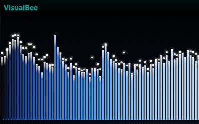
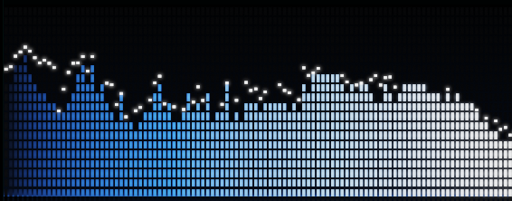
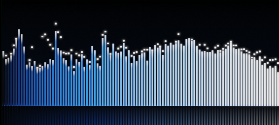
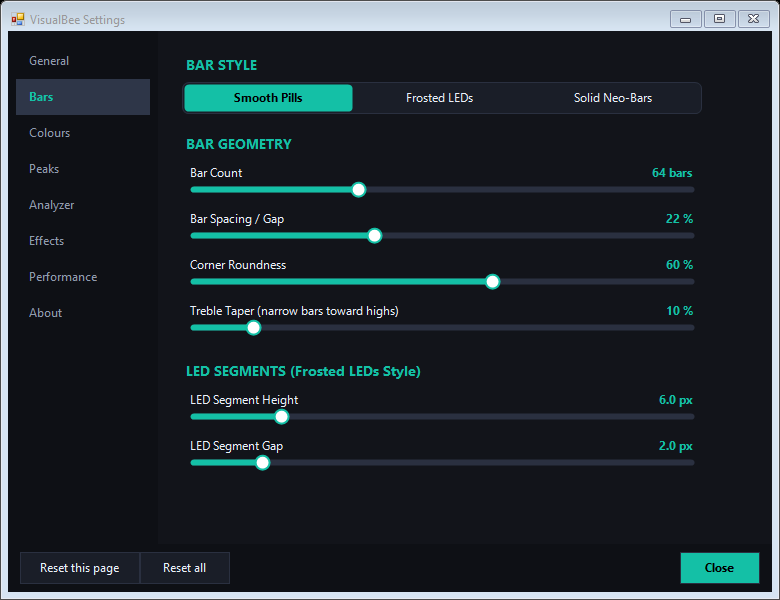

# VisualBee

VisualBee is a fast, hardware-accelerated spectrum bar visualizer for [MusicBee](https://getmusicbee.com/). It renders through DirectX 11 flip-model presentation, meaning it runs cleanly at high refresh rates (60Hz, 120Hz, 144Hz, 240Hz) with minimal CPU and GPU usage and without locking up MusicBee.



---

## Previews

| LED Segmented Blocks | Smooth Bars with Reflections |
| :---: | :---: |
|  |  |

| Settings Window |
| :---: |
|  |

---

## Features

- **Custom bar styles**: Solid bars, rounded pills, or retro LED segment blocks with adjustable spacing and height.
- **Color modes**: Vertical gradients, frequency-based color spreads, solid tips, or cycling hues.
- **Physics & dynamics**: Configurable attack and decay speeds, peak hold times, falling gravity, and treble tilt EQ.
- **Eye candy**: Optional floor reflections with opacity falloff, corner rounding, and vignette edges.
- **High refresh rates**: Native support for 60 fps up to 240 fps (or uncapped).
- **Dedicated settings window**: Clean dark UI that opens modelessly so you can see your adjustments in real time without freezing playback.
- **Self-contained**: Single `mb_VisualBee.dll` file. All DirectX dependencies are embedded directly, so there are no extra runtimes to install.

---

## Installation

### Method 1: MusicBee Preferences (Easiest)
1. Download **`mb_VisualBee.dll`** (or grab `VisualBee_v1.0.zip`) from the [`release/`](release/) folder.
2. Open MusicBee and press `Ctrl + O` (or go to **Edit** > **Preferences**).
3. Select **Plugins** on the left, click **Add Plugin**, and pick `mb_VisualBee.dll`.
4. Click **Apply** and restart MusicBee.

### Method 2: Manual Drop-in
1. Close MusicBee.
2. Copy `mb_VisualBee.dll` into your MusicBee `Plugins` folder:
   - Standard: `C:\Program Files (x86)\MusicBee\Plugins\`
   - Portable: `<MusicBee Folder>\Plugins\`
   - Microsoft Store: `%APPDATA%\MusicBee\Plugins\`
3. Start MusicBee.

---

## How to Use

1. **Add it to your layout**: Go to **View** > **Arrange Panels...**, then drag **VisualBee Visualizer** wherever you want it (sidebar, bottom panel, main view, etc.) and hit Save.
2. **Popout window**: Right-click the visualizer and select **Popout Window** if you want it floating on a second monitor.
3. **Change settings**: Right-click the visualizer and click **Settings...** (or go to **View** > **VisualBee Settings**). You can adjust bar styles, colors, physics, and frame rates while your music is playing.

---

## Building from Source

Requires .NET Framework 4.8 and .NET SDK 8+.

```bash
git clone https://github.com/Taffyex/VisualBee.git
cd VisualBee
dotnet build VisualBee.sln -c Release
```

The output file will be at `src/VisualBee/bin/mb_VisualBee.dll`.

---

## License

MIT License - feel free to modify, fork, or share.
