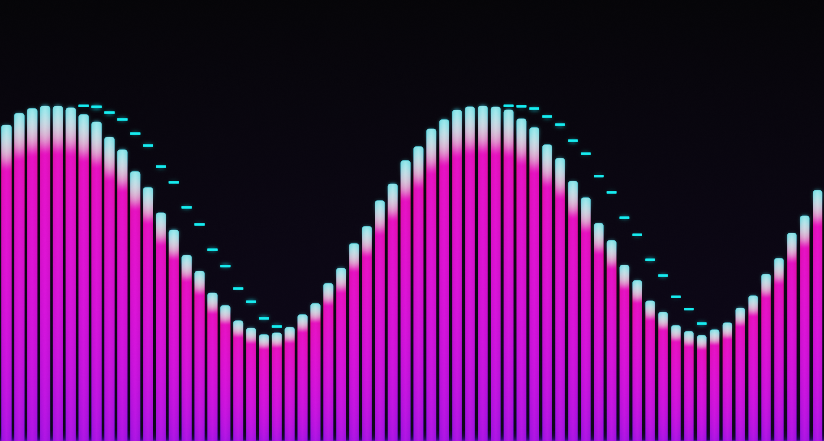
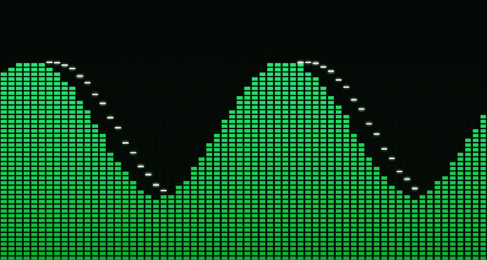
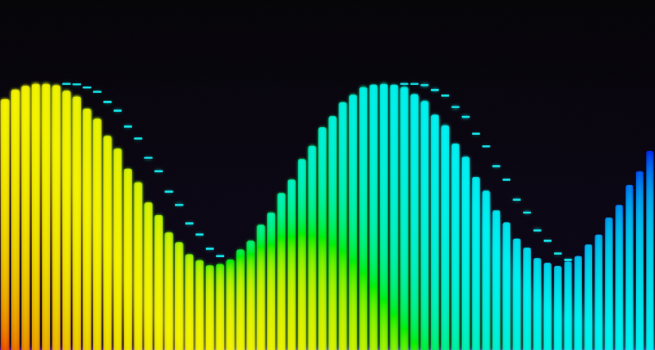
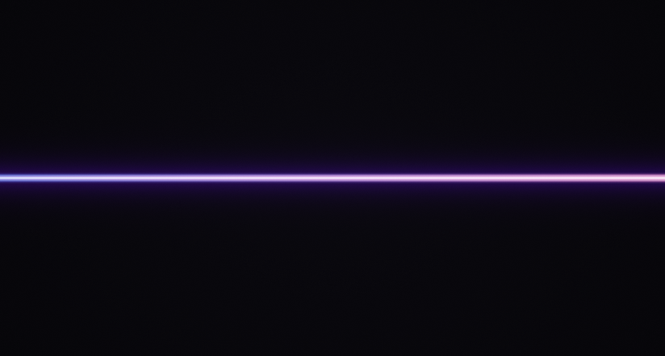
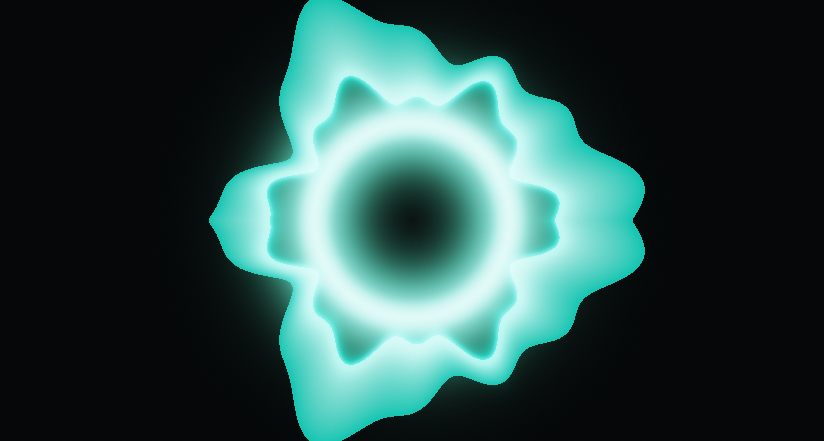

# VisualBee 🐝

[](https://github.com/Taffyex/VisualBee/releases)
[-blue.svg)]()
[]()
[]()
[](LICENSE)

**VisualBee** is a high-performance, hardware-accelerated **Direct3D 11** audio visualizer plugin for [MusicBee](https://getmusicbee.com/). Engineered with flip-model presentation, low-latency DSP taps, customizable bar dynamics, and a dedicated modeless settings suite.

---

## 📸 Screenshots

| Rounded Pills Spectrum | LED Segmented Blocks |
| :---: | :---: |
|  |  |

| Frequency Gradient & Floor Reflection | Ribbon Waveform |
| :---: | :---: |
|  |  |

| Radial Nova | Modeless Settings Window |
| :---: | :---: |
|  |  |

---

## ✨ Features

- **Direct3D 11 Hardware Acceleration**:
  - True DXGI flip-model presentation (`DXGI_SWAP_EFFECT_FLIP_DISCARD`).
  - High refresh rates: silky smooth 60 Hz, 120 Hz, 144 Hz, 240 Hz, or uncapped.
  - Sub-millisecond render pass times and minimal CPU/GPU overhead.
- **Dedicated Modeless Settings Dialog**:
  - Floating 780×600 configuration window (`View > VisualBee Settings` or Right-Click > `Settings`).
  - Custom owner-drawn dark theme with segmented tabs, precision sliders, toggles, and live color pickers.
  - Settings apply instantly with debounced, thread-safe persistence.
  - One-click diagnostics report generator.
- **Customizable Bar Geometry & Shaders**:
  - **3 Bar Shapes**: Solid Rectangles, Rounded Pills, and LED Segmented Blocks.
  - Adjustable LED segment height and vertical spacing.
  - Continuous corner roundness (0% to 100%).
  - Treble taper width control.
  - Floor reflection with realistic opacity falloff.
  - Edge vignette shading.
- **Multiple Visualizer Modes**:
  - **Bars**: Classic and modern multi-band spectrum analyzer.
  - **Waveform / Ribbon**: Smooth audio oscilloscope with filled glowing floor.
  - **Radial Nova**: Circular frequency burst for circular/album art layouts.
  - **Phase Scope**: Stereo Lissajous field analyzer.
  - **VU Meter**: Analog-style peak/RMS meters.
- **Rich Color Palettes & Dynamics**:
  - 4 Shading Modes: Vertical Gradient, Across Frequencies (Rainbow), Solid Tip, and Dynamic Hue Cycle.
  - Customizable base, tip, and floating peak cap colors.
  - 4 Symmetry / Mirror Modes: Off, Horizontal, Vertical, and Both (quadrant mirror).
- **Pro Audio Engine**:
  - Direct 64-bit BASS audio tap from MusicBee.
  - Gaussian FFT windowing and logarithmic frequency distribution.
  - Independent Attack and Decay smoothing times (ms).
  - Floating peak cap physics with configurable hold duration and gravity acceleration.
  - Treble tilt EQ curve (+0 dB to +24 dB) and dynamic floor threshold (-90 dB to -20 dB).
- **Zero External Dependencies**:
  - Single standalone `mb_VisualBee.dll` file.
  - Direct3D 11 (SharpDX) runtimes are embedded directly into the DLL assembly.

---

## 🚀 Installation Guide

### Option 1: Automatic / UI Install (Recommended)
1. Download **`mb_VisualBee.dll`** (or unzip **`VisualBee_v1.0.zip`**) from the [**`release/`**](release/) folder or the [**GitHub Releases**](https://github.com/Taffyex/VisualBee/releases) tab.
2. Open MusicBee and go to:
   - **Edit** > **Preferences** (`Ctrl + O`) > **Plugins**.
3. Click **Add Plugin** and select `mb_VisualBee.dll`.
4. Click **Apply** / **Save**, then restart MusicBee.

### Option 2: Manual Install
1. Close MusicBee.
2. Copy `mb_VisualBee.dll` into your MusicBee `Plugins` folder:
   - **Standard Installer**: `C:\Program Files (x86)\MusicBee\Plugins\`
   - **Portable Version**: `<Your MusicBee Folder>\Plugins\`
   - **Windows Store Version**: `%APPDATA%\MusicBee\Plugins\`
3. Launch MusicBee.

---

## 🎮 How to Use

### 1. Docking the Visualizer
- Go to MusicBee menu > **View** > **Arrange Panels...**
- Drag **VisualBee Visualizer** into any dock slot:
  - Right sidebar / Left sidebar
  - Bottom panel (under track list or player controls)
  - Main panel tab
- Click **Save**.

### 2. Standalone Popout Window
- Right-click anywhere inside the VisualBee visualizer panel and select **Popout Window** (or use the MusicBee menu command).
- Resize or move the visualizer to a secondary monitor or TV.

### 3. Opening Settings
- Right-click the visualizer > **Settings...**
- Alternatively, open from the top menu: **View** > **VisualBee Settings**.
- Adjust bars, colors, dynamics, audio EQ, and frame rates in real-time!

---

## 🛠️ Building from Source

### Prerequisites
- Windows 10 / 11 (x64 / x86)
- [.NET Framework 4.8 Developer Pack](https://dotnet.microsoft.com/download/dotnet-framework/net48)
- [.NET SDK 8.0+](https://dotnet.microsoft.com/download) or Visual Studio 2022

### Build Steps
1. Clone this repository:
   ```bash
   git clone https://github.com/Taffyex/VisualBee.git
   cd VisualBee
   ```
2. Build the solution in Release mode:
   ```bash
   dotnet build VisualBee.sln -c Release
   ```
3. The standalone compiled plugin will be generated at:
   ```
   src/VisualBee/bin/mb_VisualBee.dll
   ```

---

## 🤝 Sharing with Friends

Want to share VisualBee with a friend?
1. **Send the Direct DLL**: Simply send them `release/mb_VisualBee.dll` or `release/VisualBee_v1.0.zip`. They just drop it into their MusicBee `Plugins` folder!
2. **Send the GitHub Link**: Share `https://github.com/Taffyex/VisualBee` so they can read the guide, check the screenshots, and download the latest release.

---

## 📜 License

This project is licensed under the **MIT License** - see the [LICENSE](LICENSE) file for details.

---

## 💡 Acknowledgements
- [MusicBee](https://getmusicbee.com/) by Steven Mayall for the best music manager and player on Windows.
- [SharpDX](http://sharpdx.org/) for Direct3D 11 managed interop.
