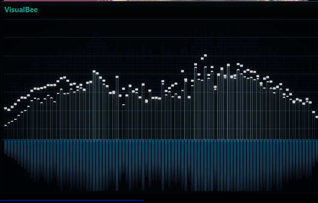
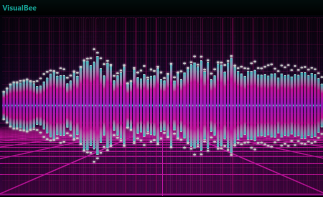
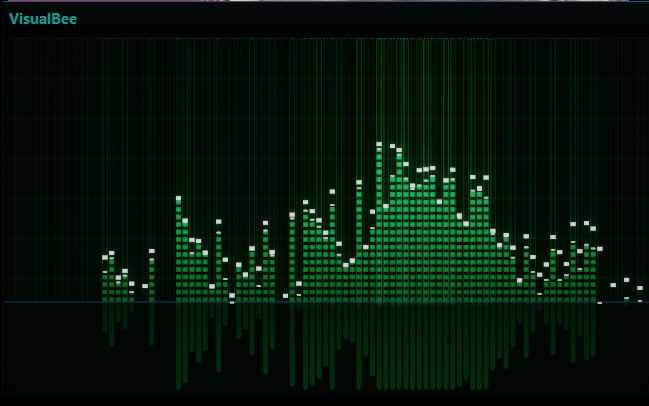
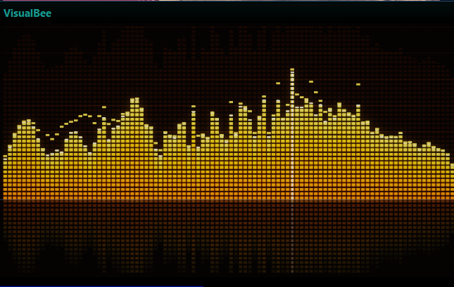
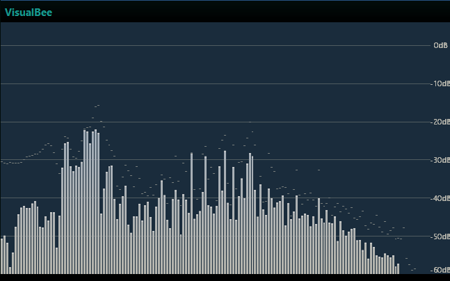
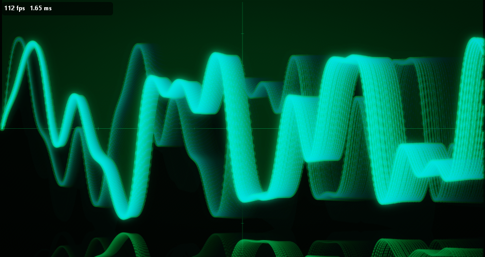
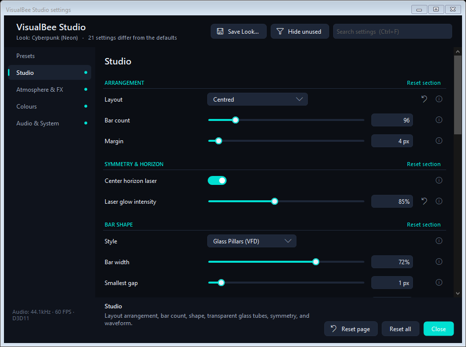

# VisualBee v2.2.31

VisualBee is an ultra high-performance, hardware-accelerated **Direct3D 11 spectrum analyzer and phase-locked analog oscilloscope** for [MusicBee](https://getmusicbee.com/). Engineered with zero managed wrappers and pure native DirectX 11 P/Invoke, it delivers buttery-smooth 120Hz/144Hz visuals, physical optical glass refraction, authentic VFD/Nixie vacuum tube incandescence, and studio CRT waveform monitoring at <1% CPU and <3% GPU load.

---

## Installation

### Quick Install (Recommended)
1. Download **[`VisualBee_v2.2.31.zip`](https://github.com/Taffyex/VisualBee/releases/download/v2.2.31/VisualBee_v2.2.31.zip)** (or raw **[`mb_VisualBee.dll`](https://github.com/Taffyex/VisualBee/releases/download/v2.2.31/mb_VisualBee.dll)**) from the [latest release](https://github.com/Taffyex/VisualBee/releases).
2. In MusicBee, press `Ctrl + O` (or go to **Edit** > **Preferences**).
3. Select **Plugins** in the sidebar, click **Add Plugin**, and choose the downloaded file (`VisualBee_v2.2.31.zip` or `mb_VisualBee.dll`).
4. Click **Apply** and restart MusicBee.

### Manual Drop-in
1. Close MusicBee.
2. Copy `mb_VisualBee.dll` into your MusicBee plugins directory:
   - **Installer edition:** `C:\Program Files (x86)\MusicBee\Plugins\`
   - **Portable edition:** `<MusicBee Folder>\Plugins\`
   - **Windows Store:** `%APPDATA%\MusicBee\Plugins\`
3. Launch MusicBee.

---

## Visual Showcase — Style Gallery

| VFD Glass Pillars (Vacuum Enclosure) | Synthwave CyberGrid (Mirrored 3D Perspective) |
| :---: | :---: |
|  |  |

| Green Matrix LED Ladder Rungs | Amber Studio Segments & Horizon Reflection |
| :---: | :---: |
|  |  |

| Decibel Graticule Studio Solid Bars | Phase-Locked Analog CRT Oscilloscope |
| :---: | :---: |
|  |  |

---

## Real-Time VisualBee Studio Rack

Configure presets, bar optics, bloom intensity, color palettes, and audio acoustics in real time with the new modular Studio Rack interface:

- **Top Studio Deck Navigation**: 5 horizontal tabs (`Presets`, `Studio`, `Optics & FX`, `Colours`, `Audio`).
- **Persistent Quick-Switch Ribbon**: Instant 1-click preset switching, active palette chips, and live FPS / sample-rate telemetry.
- **Hardware Rack Architecture**: Responsive 2-column cards with warm amber indicator lights and per-section resets.
- **Dual Tooltip Guidance**: Plain-English hover cards explaining exact acoustic physics and shader parameters.

---

## What's New in VisualBee v2.2.31

### 1. Low-Latency Causal Windowing & AGC Level Matching
- **Zero-Latency Transients**: Standard symmetric analysis windows place their peak in the past ($N/2$), introducing 85–340 ms visual lag. Causal windowing weights live samples near the playhead ($0.82(N-1)$), synchronizing visual bars instantly with sound transients.
- **Loopback Level Matching (AGC)**: WASAPI loopback captures post-fader system audio, typically 15–25 dB below pre-fader BASS levels. Intelligent slow-release AGC ensures loopback audio produces punchy, full-height bars and clean beat detection.
- **Sub-Packet 144Hz–240Hz Interpolation**: Eliminates 25ms timer sleeps by predicting sub-packet playhead progression with high-precision timestamps for stutter-free 144Hz/240Hz rendering.

### 2. Audio Engine Robustness & Process Loopback Fix
- **Zero-Injection Dropout Elimination**: Replaced destructive 128-zero frame injections during stream gaps with smooth exponential idle decay, eliminating audio clicks and visual flutter.
- **Windows 10/11 Process Loopback COM Activation**: Wrapped activation parameters inside `PROPVARIANT` (`VT_BLOB`) and implemented `IAgileObject` on `ProcessLoopbackHandler`, enabling per-process isolation (`MusicBee process (isolated)`) without crashes.
- **Multichannel Downmixing**: Added ITU-R BS.775 matrices for stereo, quad, 5.1, and 7.1 surround downmixing across float, 32-bit int, 24-bit int, and 16-bit PCM.
- **Phase-Locked Oscilloscope Real-Time Tracking**: Oscilloscope triggering now samples the live playhead directly, removing 340ms waveform delay.

---

## What's New in VisualBee v2.1.3

### 1. Dynamic Audio Endpoint & Virtual Cable Selection
- **Device Selector Dropdown**: Direct selection of physical outputs (speakers, headphones, HDMI) or virtual audio cables (VB-Audio Virtual Cable, Voicemeeter, Virtual Audio Router).
- **Dynamic Re-Enumeration**: Automatically scans and lists newly plugged USB audio devices or newly configured virtual endpoints whenever the device dropdown opens.
- **Direct Context Menu Routing**: Switch between BASS Direct Tap and WASAPI Loopback, or select your target playback device directly from the right-click context menu.

### 2. Process-Isolated Loopback (Windows 10/11)
- **Targeted Application Capture**: Leverages Windows CoreAudio process-loopback activation (`VAD\Process_Loopback`) on Windows 10 (build 20348+) and Windows 11 to capture audio strictly from MusicBee and secondary media players without recording VoIP chats (Discord, Teams), game sounds, or system alerts.

### 3. Low-Latency Event-Driven Engine & Sync Delay
- **Event-Driven Buffering**: Upgraded WASAPI capture loop to `AUDCLNT_STREAMFLAGS_EVENTCALLBACK` with a 50 ms ring buffer, native PCM negotiation, and smooth idle decay when audio stops.
- **Configurable Audio Sync Delay**: Added 0 ms to 500 ms audio delay compensation slider in settings to align visuals with Bluetooth audio latency or external DAC DSP buffering.
- **Audio Diagnostics Telemetry**: Live status badge and detailed tooltip showing the active endpoint ID, capture state, sample rate, and channel format.

---

## What's New in VisualBee v2.1.2

### 1. Settings Window Polish & Search
- **Invisible Search Results Fixed**: Corrected search card measurement and layout so matching setting rows render properly.
- **Dynamic Section Card Visibility**: Conditional section cards (Album Art, Aurora, LED/VFD Segments, Radial) unhide immediately when dependencies switch without requiring page navigation.
- **Responsive 2-Column Card Scaling**: Adjusted label widths and control sizing to prevent text clipping and overflow.

### 2. Optics & Skin Transparency
- **Transparent Background Mode**: Added `Transparent` background mode under `Optics & FX` -> `Background` that seamlessly adapts to the active MusicBee skin background color and gradients.
- **Dynamic Skin Invalidation**: Automatically updates and repaints the background texture when the MusicBee skin changes at runtime.

### 3. Presets & Docking Self-Healing
- **Cover Art Chameleon Preset**: Restored adaptive cover palette colors, cover blur, and opacity settings.
- **Dock Self-Healing Restored**: Re-enabled dock metric self-healing and scrollbar overhang suppression.

---

## What's New in VisualBee v2.1.1

### 1. Robust Audio Engine & Startup Hook Binding
- **Direct BASS Audio Hook Fix**: Eliminated the startup race condition where Direct BASS audio capture remained unbound until manual pause/unpause. Audio capture now automatically and lazily binds on the very first audio frame rendered and on player state changes.
- **Resilient Method Handle Generation**: Replaced dynamic IL opcode generation with strongly typed, CLR-verified Expression Trees and fallback reflection to ensure seamless execution across all .NET runtime configurations.
- **Smart WASAPI Loopback Lifecycle**: WASAPI loopback capture now dynamically starts and stops with visualizer panel visibility, preventing background thread execution and idle CPU usage when the visualizer is closed.
- **32-bit Integer PCM Support**: Fixed distorted or silent audio on WASAPI loopback for 32-bit integer audio interfaces by properly detecting `WAVE_FORMAT_EXTENSIBLE` subformats and normalizing signed PCM.

### 2. High-Performance Math & Zero-Allocation Render Loop
- **Zero Heap Allocations**: Added thread-static target clear vectors to Direct3D 11 pass pipelines, completely eliminating GC allocations in the 144Hz render loop.
- **Pinned Pointer Math**: Re-engineered Discrete Fourier Transform (DFT) windowing and Fast Fourier Transform (FFT) passes with unsafe pinned pointer arithmetic, stripping out array bounds checks in time-critical audio calculation paths.
- **Open Generic Memory Safety**: Upgraded generic vertex and geometry streams to pinned `GCHandle` marshaling, fully passing strict CLR verifications.

---

## What's New in VisualBee v2.1

### 1. Panel Docking Self-Healing & Metric Protection
- **No More Fullscreen Traps**: Fixed the critical MusicBee issue where embedding a visualizer panel in sidebars or bottom panels could corrupt layout metrics into a 65,734px height loop that persisted even after deleting the DLL.
- **Automated Self-Healing (`HealPanelMetrics`)**: Automatically repairs corrupted panel metrics in memory and inside `MusicBee3Settings.ini` back to clean, resizable dimensions.
- **Zero Scrollbar Overhang**: Stripped unwanted 17px rightward overhang by disabling MusicBee's internal vertical scrollbar flags via reflection and clipping the DirectX swapchain directly to the visible dock container region.
- **Polished Fullscreen Toggle**: Fullscreen visualizer window is now non-intrusive (`TopMost = false`), allowing seamless Alt+Tab multitasking and clean toggle via double-click, `F11`, or `Escape`.

### 2. Physical Separation: Glass Pillars vs. Nixie Rungs
- **Pure Refractive Glass Pillars (`StyleGlass`)**: Refactored into a crystal cylinder column with Fresnel edge reflections, Snell's law chromatic dispersion, and fluid core glow with zero ladder rungs.
- **Authentic Nixie & VFD Rungs (`StyleNixie`)**: Re-engineered with dual metallic anode guide wires, laser-cut filament ladder rungs, hexagonal cathode wire mesh, and smoked bronze vacuum envelopes.
- **GlassFill Optics Selector**: Added 4 distinct tube fill modes: `Pure Crystal Glass`, `Bioluminescent Plasma`, `Glowing Filaments`, and `Stepped Ladder Rungs`.

### 3. 12 Hand-Crafted Studio Presets & 10 Palettes
- **100% Original Presets**: Purged all legacy presets and introduced 12 original factory presets:
  - *Dieter Studio LED* (Braun/Rams minimalist reference meters)
  - *Nixie Amber Tube* (Warm incandescent vacuum filaments)
  - *Borosilicate VFD* (Refractive cyan-teal laboratory tube)
  - *Tektronix P31 Scope* (Phase-locked green phosphor CRT waveform monitor)
  - *Quartz Prism 3D* (Snell's dispersion chromatic crystal columns)
  - *Cyberpunk 2099* (Hot magenta & cyan neon overdrive)
  - *Matrix Phosphor* (Monochrome green terminal cascade)
  - *Liquid Mercury* (High-contrast metallic chrome reflection)
  - *Solar Flare* (Thermonuclear gold & deep orange incandescence)
  - *Cryo Frost* (Sub-zero ice blue pillars with horizon mist)
  - *Dark Matter* (Deep obsidian stealth meters with violet tips)
  - *Acid Techno* (High-energy electric lime strobe bars)
- **10 Curated Studio Palettes**: *Cryo Cyan*, *Nixie Amber*, *Ultraviolet*, *Emerald CRT*, *Solar Flare*, *Deep Ocean*, *Rose Quartz*, *Gold Reference*, *Titanium Mono*, and *Acid Lime*.

---

## Usage & Controls

- **Layout Placement**: Go to **View** > **Arrange Panels...**, then drag **VisualBee Visualizer** to your preferred dock slot (main panel, bottom panel, or sidebars).
- **Popout Window**: Right-click the visualizer and choose **Popout Window** for dedicated multi-monitor viewing.
- **Full Screen**: Double-click or press `F11` to toggle full-screen visualizer mode. Press `Escape` or `F11` to exit.
- **Settings Studio**: Right-click the visualizer and select **Open VisualBee Studio...** (or `Ctrl + Shift + V`) to open the real-time studio rack.
- **Quick Keyboard Shortcuts**:
  - `Ctrl + Shift + L`: Next visual layout
  - `Ctrl + Shift + P`: Next preset
  - `Ctrl + Shift + V`: Open VisualBee Studio

---

## Architecture & Code Quality

VisualBee strictly adheres to high-performance systems programming and modularity standards:
- **Assembly Size**: 435 KB (x86, `.NET Framework 4.8`, native Direct3D 11).
- **Zero Heap Allocations in Render Loop**: Discard-mapped dynamic ring buffers.
- **Zero Managed Wrappers**: Direct native P/Invoke to DirectX 11 and DXGI runtime binaries.
- **License**: MIT
